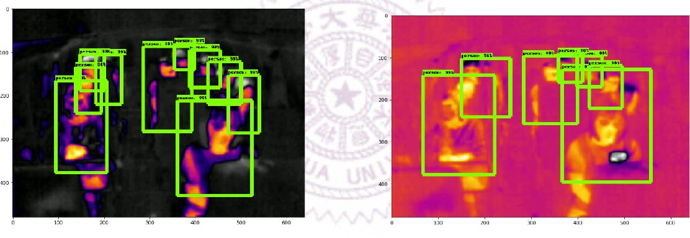
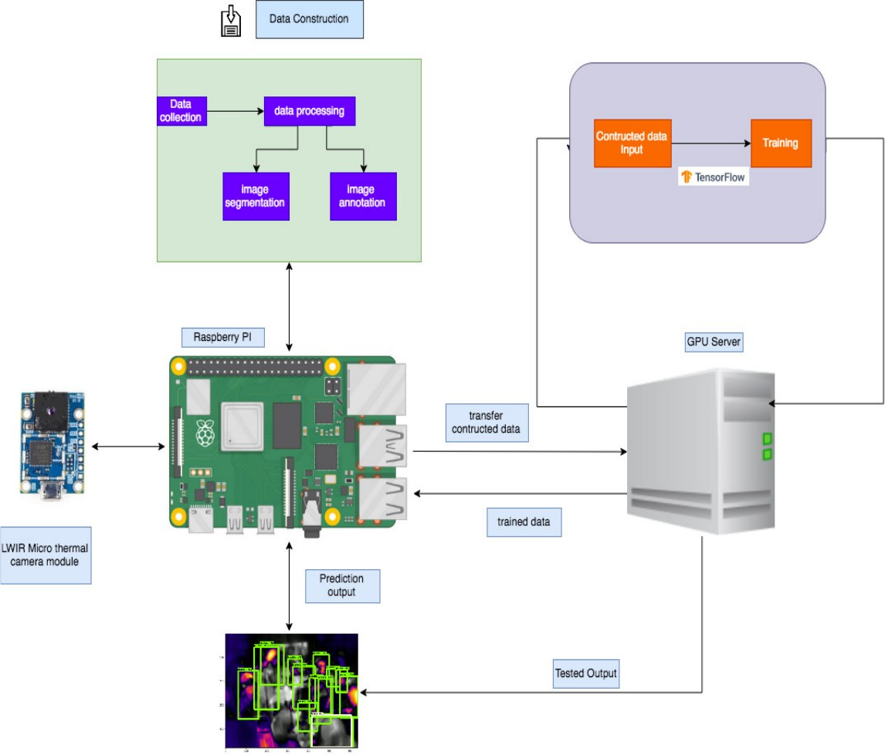
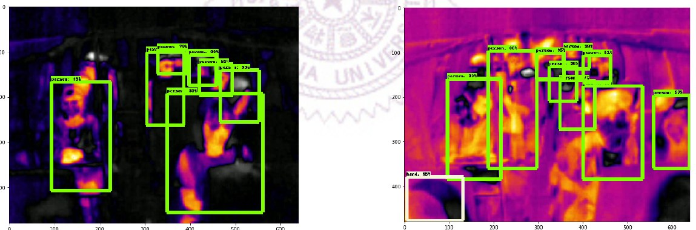

# Smart Public Transport — Thermal Passenger Detection with Deep Learning

Real-time passenger counting on a bus using a **long-wave infrared (thermal) camera**, **TensorFlow object detection** and a **Raspberry Pi** edge device.
Thermal imaging works day and night and protects privacy (no faces are captured), so the system can report how many seats are free without recording identifiable video.

> M.S. thesis project — Institute of Communications Engineering, National Tsing Hua University, Taiwan (2020).
> Author: **Anto Joeis** · Advisor: Dr. Nen-Fu Huang



## Highlights

| | Faster R-CNN (Inception v2) | SSDLite (MobileNet v2) |
|---|---|---|
| Test accuracy | **91.3 %** | 76.55 % |
| Speed on GPU server | 6 FPS | **9 FPS** |
| Final training loss | 0.177 | 0.250 |
| Training time (8 GB GPU) | 6 hours | 1 day 4 hours |
| Speed on Raspberry Pi | 30 s / frame | **1.2 s / frame** |

- **Custom thermal dataset:** 1,671 hand-annotated 640×480 IR frames (1,509 train / 162 test) with **~10,000 bounding boxes** across 9 classes.
- Collected with a **FLIR Lepton 3.5** radiometric LWIR camera on a PureThermal 2 board, recorded on a Raspberry Pi to HDF5, then extracted, segmented and annotated.
- Trained two detectors with transfer learning (TensorFlow Object Detection API) and benchmarked accuracy vs. speed for **edge deployment**: Faster R-CNN is the most accurate, SSDLite is the practical choice on a Raspberry Pi.

## System design



1. **Capture** — Lepton 3.5 LWIR camera → Raspberry Pi records radiometric frames (HDF5 keeps the Pi's CPU load low).
2. **Data construction** — extract frames, segment, annotate with LabelImg (Pascal-VOC XML) → CSV → TFRecord.
3. **Training** — transfer learning on a GPU server from COCO-pretrained Faster R-CNN Inception v2 and SSDLite MobileNet v2 (200k steps each).
4. **Edge inference** — export frozen graph → run detection on the Raspberry Pi → passenger count → free-seat estimate.

### Classes

People are the target class. Hot non-living objects are labelled separately so the model learns not to count them as passengers:

`person` · `hand` · `mobile` · `cpu` · `monitor` · `charger` · `light` · `chicken noodle soup` · `tomato soup`

| Class | Boxes (train) |
|---|---|
| person | 5,199 |
| cpu | 2,254 |
| light | 921 |
| monitor | 518 |
| tomato soup | 335 |
| hand | 289 |
| chicken noodle soup | 263 |
| charger | 104 |
| mobile | 7 |

## Results

**Faster R-CNN** — highest accuracy (91.3 %), best at separating overlapping passengers (see image at top).

**SSDLite** — faster and light enough for the Raspberry Pi, but misses more objects (76.55 %):



Known limitation: overlapping people and strong heat sources can merge into one thermal blob, causing missed or wrong detections for both models.

## Repository layout

```
configs/
  labelmap.pbtxt                         # 9 thermal classes
  faster_rcnn_inception_v2_thermal.config
  ssdlite_mobilenet_v2_thermal.config
data/
  train_labels.csv  test_labels.csv      # all bounding-box annotations
scripts/
  xml_to_csv.py                          # LabelImg XML -> CSV
  generate_tfrecord.py                   # CSV + images -> TFRecord
  detect_video.py                        # run a trained model on a video
samples/                                 # example thermal frames
docs/images/                             # figures from the thesis
```

## How to reproduce

Built on TensorFlow 1.x and the [TensorFlow Object Detection API](https://github.com/tensorflow/models/tree/master/research/object_detection).

```bash
# 1. Annotations -> CSV (if you start from LabelImg XML files)
python scripts/xml_to_csv.py

# 2. CSV -> TFRecord
python scripts/generate_tfrecord.py --csv_input=data/train_labels.csv --image_dir=images/train --output_path=train.record
python scripts/generate_tfrecord.py --csv_input=data/test_labels.csv  --image_dir=images/test  --output_path=test.record

# 3. Train (replace PATH_TO_OBJECT_DETECTION in the config first)
python train.py --logtostderr --train_dir=training/ \
  --pipeline_config_path=configs/faster_rcnn_inception_v2_thermal.config

# 4. Export and run on video
python export_inference_graph.py --input_type image_tensor \
  --pipeline_config_path configs/faster_rcnn_inception_v2_thermal.config \
  --trained_checkpoint_prefix training/model.ckpt-XXXX --output_directory inference_graph
python scripts/detect_video.py
```

The full image dataset (~760 MB) and trained weights are not included because of size; they are available on request.

## Tech stack

Python · TensorFlow · TensorFlow Object Detection API · Faster R-CNN · SSD / MobileNet · OpenCV · Raspberry Pi · FLIR Lepton 3.5 · HDF5 · LabelImg

## Credits

- `xml_to_csv.py` and `generate_tfrecord.py` are adapted from [datitran/raccoon_dataset](https://github.com/datitran/raccoon_dataset) (MIT).
- `detect_video.py` is adapted from Evan Juras' TensorFlow object-detection tutorial, which builds on Google's example.
- Model configs are derived from the TensorFlow Object Detection API sample configs (Apache 2.0).

## Contact

**Anto Joeis** — AI/ML Engineer · [LinkedIn](https://www.linkedin.com/in/anto-joeis) · antojoeis@gmail.com
